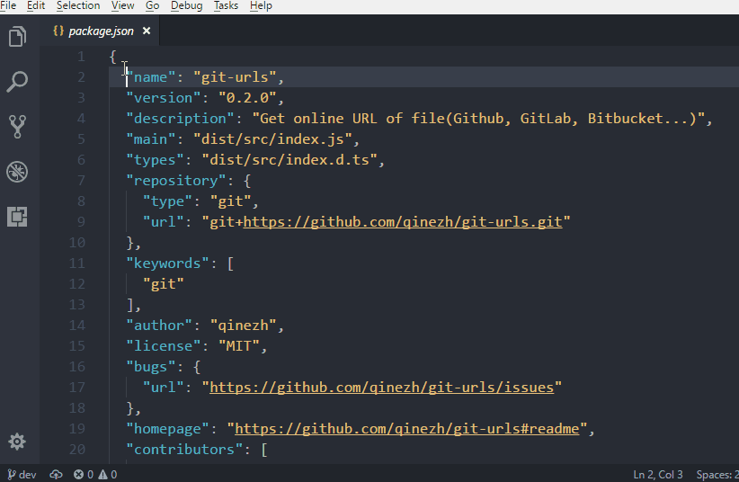

# GitLink

Inspired by GitHub extension for Visual Studio, this extension provide features that **Go To** current file's online link in browser and **Copy** the link in clipboard.

## Features

1. Go to the online link of current file.
2. Copy the online link of current file.
3. Supported git repo platforms:
    1. GitHub
    2. GitLab
    3. Azure DevOps
    4. BitBucket
    5. VSTS

## Usage



### Set default remote source

When your project has multiple git remotes, you need to choose the git remote before the git link is generated. If you don't want to choose it every time, you could set the default remote source:

**Workspace Level**: add `gitlink.defaultRemote: "<your_default_remote_source_name>"` in `.vscode/settings.json` under the root of your workspace.

**Global Level**: toggle the preference of vscode, and add `gitlink.defaultRemote: "<your_default_remote_source_name>"` in User Settings.

Please note, you could get the name of your remote sources by the command: `git remote -v`:

```bash
# example
$ git remote -v
origin  git@github.com:qinezh/vscode-gitlink (fetch)
origin  git@github.com:qinezh/vscode-gitlink (push)
upstream        git@github.com:upstream/vscode-gitlink.git (fetch)
upstream        git@github.com:upstream/vscode-gitlink.git (push)
```

And the sample `settings.json` could be like:
```json
{
    "gitlink.defaultRemote": "upsteam"
}
```

**Enjoy!**
